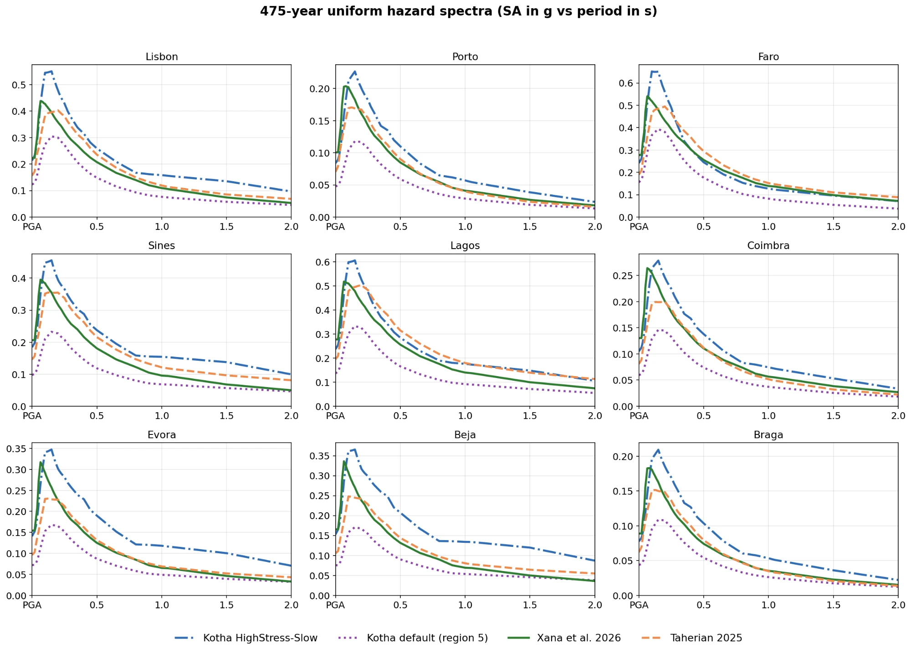
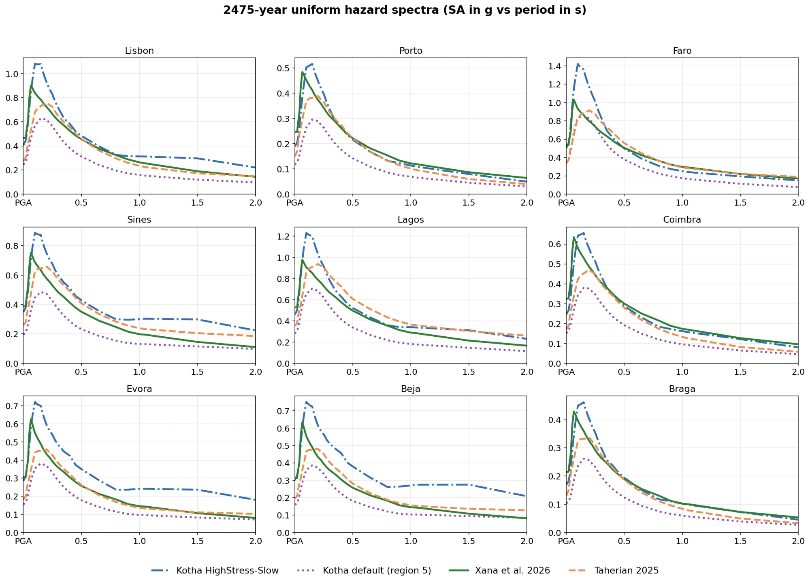

# Validation of Ground-Motion Models (GMMs) for Probabilistic Seismic Hazard Analysis in Portugal

This repository contains the data, the model files and the figures of a validation study.
The goal is to find which ground-motion models (GMMs) are most suitable for
Probabilistic Seismic Hazard Analysis (PSHA) in Portugal.

We compare the model predictions with **observed strong-motion and weak-motion records**
from Portuguese seismic stations, for two source regions:

* **Inland** (events on land / near the coast)
* **Offshore** (events in the Atlantic, SW Iberia)


---

## 1. Models compared

| Short name in figures | Description | File in `data/gmm_files/` |
|---|---|---|
| Xana et al. 2026 (inland / offshore) | Published regional model (class `Morgadoetal2026_*`). Inputs: magnitude and Rjb only. | `xana_2025_inland.py`, `xana_2025_offshore.py` |
| Taherian 2025 (inland / offshore) | Our model, a regression on EXSIM stochastic simulations. For Mw > 6 the spectral shape is replaced by the Kotha et al. (2020) shape. Variance terms (τ, φ) from Taherian et al. (2024). Rock reference (Vs30 = 760 m/s). | `taherian_2025_inland.py`, `taherian_2025_offshore.py` |
| Kotha 2020 HighStress-Slow | Kotha et al. (2020) ESHM20 model with `sigma_mu_epsilon = 1.35563` and `c3_epsilon = 1.732051`. ESHM20 region 0 (inland) and region 5 (offshore). | `kotha_2020.py` (OpenQuake copy) |
| Kotha 2020 (ESHM20 region 5, c3_epsilon = 0) | Kotha et al. (2020), region 5 for both inland and offshore, central value of the anelastic term. | `kotha_2020.py` (OpenQuake copy) |

Settings used in the validation:

* Vs30 = 760 m/s (rock reference) for all models
* Hypocentral depth = 10 km, rake = -90° (normal faulting) where the model needs them
* Kotha 2020: `vs30measured = True` inland, `False` offshore
* Intensity measures: PGA and spectral acceleration (SA) at periods from 0.05 s to 1.0 s

**Important:** `kotha_2020.py` is the unchanged OpenQuake 3.23 source. It runs only inside an
OpenQuake installation. The Taherian files are self-contained (coefficients are inside the file),
but they also need OpenQuake (`openquake.hazardlib`) to be imported.

---

## 2. Observed data

The folder `data/observed_data/` has the records used in the validation.

| File | Content |
|---|---|
| `observed_inland_used_in_validation.csv` | Inland: 125 records, 7 events, 16 stations, Mw 4.0–5.3, Rjb 13–273 km |
| `observed_offshore_used_in_validation.csv` | Offshore: 187 records, 26 events, 19 stations, Mw 4.0–6.0, Rjb 94–389 km |
| `original_files/vs30-stations.csv` | Vs30 (m/s) for each station |
| `original_files/psa_summary_hor.csv`, `psa_summary_hor_off.csv` | Original processed spectra, inland and offshore |

### Columns of the observed CSV files

| Column | Meaning |
|---|---|
| `event_id`, `event_time` | Earthquake identifier and origin time (inland file: yyyy-mm-dd hh:mm:ss; offshore file: dd/mm/yyyy hh:mm) |
| `station`, `channel` | Station code and horizontal component (HHE = East-West, HHN = North-South) |
| `magnitude` | Moment magnitude, Mw |
| `Rhyp`, `Rjb` | Hypocentral distance (from the station and event locations) and Joyner-Boore distance (km). `Rjb` is **not measured**: it was converted from `Rhyp` with PS2FF (see Section 2.1). |
| `PGA` | Peak ground acceleration (g) |
| `psa_0.05` … `psa_1.00` | Pseudo-spectral acceleration (g) at periods 0.05 to 1.00 s (5% damping) |
| `vs30` | Site Vs30 of the station (m/s) |
| `mw_bin` | Magnitude bin used in the plots (for example `4.3-4.6`) |

Each row is one record (one station, one component). Several rows can come from the same event.

### 2.1 Distance conversion: from hypocentral distance (Rhyp) to Rjb

The observed records were available with the **hypocentral distance (Rhyp)**, which is the distance from the station to the
point source (the hypocenter). Most GMMs, including the ones compared here, use the **Joyner-Boore distance (Rjb)**,
which is the shortest horizontal distance from the station to the surface projection of the finite fault.
For small and moderate events we do not know the fault geometry, so Rjb cannot be measured directly.

To make the observed data consistent with the GMMs, we converted Rhyp to Rjb with the
**PS2FF** toolkit (*Point Source to Finite Fault*) from the USGS: <https://github.com/usgs/ps2ff>.
PS2FF gives the expected finite-fault distance (Rjb) for a point-source distance and a magnitude. It is based on
statistical relations obtained from many simulated finite-fault ruptures, so the fault dimensions are
taken into account on average, not event by event.

Important points:

* The conversion depends on the magnitude, so each record is converted with the magnitude of its event.
* For small magnitudes and large distances, Rjb is close to Rhyp. The difference is larger for larger magnitudes
  and short distances.
* The converted Rjb is an *expected* (average) value. It has its own uncertainty, which is **not** included in the
  residuals.
* Both distances are kept in the CSV files (`Rhyp` and `Rjb`), so the conversion can be checked or repeated.

---

## 3. Procedure (how the validation was done)

1. **Select the data.** We use records from Portuguese stations with Mw ≥ 4 and on rock
   (Vs30 close to the 760 m/s reference). Records are separated into inland and offshore events.
2. **Convert the distance to Rjb.** The observed records only have the hypocentral distance (Rhyp), but the GMMs need the
   Joyner-Boore distance (Rjb). We converted Rhyp to Rjb with the USGS **PS2FF** toolkit (see Section 2.1).
   The result is stored in the column `Rjb` of the CSV files.
3. **Group by magnitude.** Records are placed in magnitude bins (`mw_bin`), so we can
   see if a model works well for small, medium or larger events.
4. **Predict with each GMM.** For every record we compute the median prediction and the
   standard deviation (σ) of each model with OpenQuake, using the same magnitude, distance and settings
   (see Section 1).
5. **Compute the residuals.** For each record and each period:

   `residual = ln(observed) − ln(predicted)`

   `normalized residual  Z = residual / σ`

   (Please check the exact sign convention in your own scripts. In this README we use observed minus predicted.)
6. **Evaluate the fit.**
   * *Residual histograms* of Z, compared with a standard normal distribution N(0,1).
   * *Mean(Z)* — the bias of the model.
   * *Ground motion vs distance* plots, with the observed data and all models.
   * *Magnitude scaling* and *response spectra* plots to check if the shapes are physically reasonable.
7. **Compare the models.** The best model has the mean of Z close to 0 and a standard
   deviation of Z close to 1, with no strong trend with distance or magnitude.

---

## 4. Figures and how to read them

The validation figures are in the folder `validation/`. It has two parts (the uniform hazard spectra are in the separate folder `UHS/`, see C below):

* **`validation/versus_observed_data/`** — the models compared with the observed records. This is the real validation.
  There is one folder for inland (`inland/`) and one for offshore (`offshore/`). Each has the residual histograms and the
  ground motion versus distance plots for each magnitude bin.
* **`validation/comparison_all_GMMs/`** — the models compared with each other (no observed data). It has the response spectra
  and the magnitude scaling plots.

### A. Models versus observed data (`validation/versus_observed_data/`)

| Figure | What it shows | How to read it |
|---|---|---|
| `inland/Residual_histograms_inland.png`, `offshore/Residual_histograms_offshore.png` | Histograms of the normalized residuals Z for each model, at several periods (PGA, 0.2 s, 0.6 s, 1 s). N is the number of records. | The ideal histogram is similar to the standard normal curve, centered at 0. **Mean(Z) > 0**: the model *under-predicts* the observations. **Mean(Z) < 0**: the model *over-predicts*. A wide histogram means that σ of the model is too small. |
| `inland/IM_vs_Rjb_Mw_X-Y.png`, `offshore/IM_vs_Rjb_Mw_X-Y.png` | Observed PGA and SA versus Rjb (log-log), for one magnitude bin (X-Y). Lines are the models. | Look if the model line goes through the middle of the observed points, and if the slope with distance is similar. A model that is above all the points over-predicts. |

### B. Comparison of all GMMs (`validation/comparison_all_GMMs/`)

| Figure | What it shows | How to read it |
|---|---|---|
| `response_spectra_inland.png`, `response_spectra_offshore.png` | Predicted response spectra (SA versus period) of the models, for Mw 5, 6 and 7 at three distances (Rjb = 10, 50 and 100 km in the inland plot). | Used to check if the shape and the level of the models are consistent, especially for large magnitudes where we have no observations. |
| `magnitude_scaling_inland.png`, `magnitude_scaling_offshore.png` | Predicted ground motion as a function of magnitude, at fixed distance. | Check that the scaling is smooth and physically reasonable (no strange jumps or saturation). |

### C. Uniform hazard spectra (`UHS/`)

The folder `UHS/` has the uniform hazard spectra (UHS) of the four GMMs, obtained from probabilistic seismic hazard
calculations for Portuguese sites. The figures are in `UHS/figures/` and the numbers are in `UHS/csv/`.

| File | What it shows | How to read it |
|---|---|---|
| `figures/UHS_475yr.png` | UHS for the 475-year return period (10% probability of exceedance in 50 years). One panel per city (Lisbon, Porto, Faro, Sines, Lagos, Coimbra, Evora, Beja, Braga), with the spectral acceleration SA (g) versus period (s) for each GMM. PGA is plotted at the left of the period axis. | Compare the level and the shape of the spectra between the GMMs. A higher curve means a higher hazard for the same return period. |
| `figures/UHS_2475yr.png` | The same for the 2475-year return period (2% probability of exceedance in 50 years). | Same as above, for a longer return period. |
| `csv/uhs_all_gmms.csv` | All UHS values used in the figures, and the values for the other sites (Setubal and Braganca). | One row per city, GMM, return period and intensity measure (see the columns below). |

**475-year uniform hazard spectra**



**2475-year uniform hazard spectra**



Columns of `uhs_all_gmms.csv`:

| Column | Meaning |
|---|---|
| `city`, `lon`, `lat` | Site name and its coordinates (degrees) |
| `gmm` | Ground-motion model (`Kotha HighStress-Slow`, `Kotha default (region 5)`, `Xana et al. 2026`, `Taherian 2025`) |
| `return_period` | Return period (years): 475 or 2475 |
| `poe_50y` | Probability of exceedance in 50 years for this return period |
| `imt`, `period_s` | Intensity measure (PGA or SA at a period) and its period in seconds (PGA is given at 0.01 s; the periods go up to 2 s) |
| `sa_g` | Spectral acceleration of the UHS (g) |

---

## 5. Repository structure

```
GMM-validation-Portugal/
├── README.md                          <- this file
├── data/
│   ├── observed_data/                 <- observed records used in the validation
│   │   ├── observed_inland_used_in_validation.csv
│   │   ├── observed_offshore_used_in_validation.csv
│   │   └── original_files/            (vs30-stations.csv, psa_summary_hor*.csv)
│   └── gmm_files/                     <- Python files of the GMMs (OpenQuake format)
├── validation/
│   ├── versus_observed_data/          <- models compared with observed records
│   │   ├── inland/                    (residual histograms + IM_vs_Rjb, by magnitude bin)
│   │   └── offshore/                  (residual histograms + IM_vs_Rjb, by magnitude bin)
│   └── comparison_all_GMMs/           <- models compared with each other
│       └── response_spectra_*.png, magnitude_scaling_*.png
└── UHS/                               <- uniform hazard spectra
    ├── figures/                       (UHS_475yr.png, UHS_2475yr.png)
    └── csv/                           (uhs_all_gmms.csv)
```

---

## 6. How to use the files

**Look at the figures:** open the `.png` files directly in GitHub.

**Read the data in Python:**

```python
import pandas as pd

df = pd.read_csv("data/observed_data/observed_inland_used_in_validation.csv")
print(df.head())
print(df.groupby("mw_bin").size())      # number of records per magnitude bin
```

**Run a model in OpenQuake** (needs `openquake.engine` installed):

```python
import numpy as np
from openquake.hazardlib.contexts import simple_cmaker
from openquake.hazardlib.imt import PGA, SA
from data.gmm_files.taherian_2025_inland import Taherian2025Inland

gmm = Taherian2025Inland()
cmaker = simple_cmaker([gmm], ["PGA", "SA(0.2)"])
# build a context with mag, rjb, hypo_depth, rake, then call cmaker.get_mean_stds(...)
```

---

## 7. Main results

*(To be completed by the author after final check of the numbers.)*

* Magnitude bins available: inland 4.0–4.6, 4.6–4.9, 4.9–5.2, 5.2–5.5; offshore 4.0–4.3, 4.3–4.6, 4.6–5.2, 5.8–6.1.
* Best model inland: …
* Best model offshore: …
* Main bias of each model (over- or under-prediction, by period and magnitude): …
* Limitations: small number of records for Mw > 5.2 and for Mw > 6 (only a few events)

---

## 8. Limitations

* The number of records is small, especially for the larger magnitudes. Bins with few events
  give less stable statistics.
* The variance terms (τ, φ, σ) of the Taherian 2025 models are taken from Taherian et al. (2024), which is the same for the inland and offshore models. They come from simulated data, not from real recordings.
* Only rock sites were used, so site effects are not validated here.

---

## 9. Citation / contact

If you use these data, please cite the related publications of the authors and the original models
(Kotha et al., 2020; Xana et al., 2026; Taherian et al., 2024).

Author: Amir Taherian
