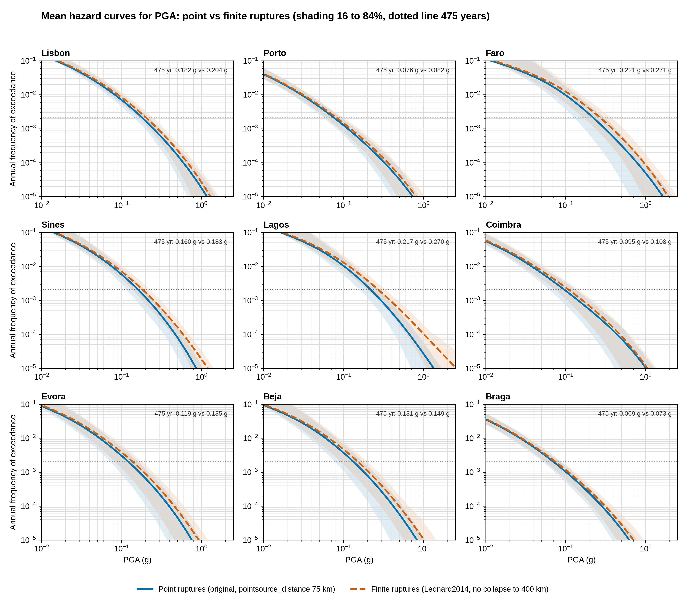
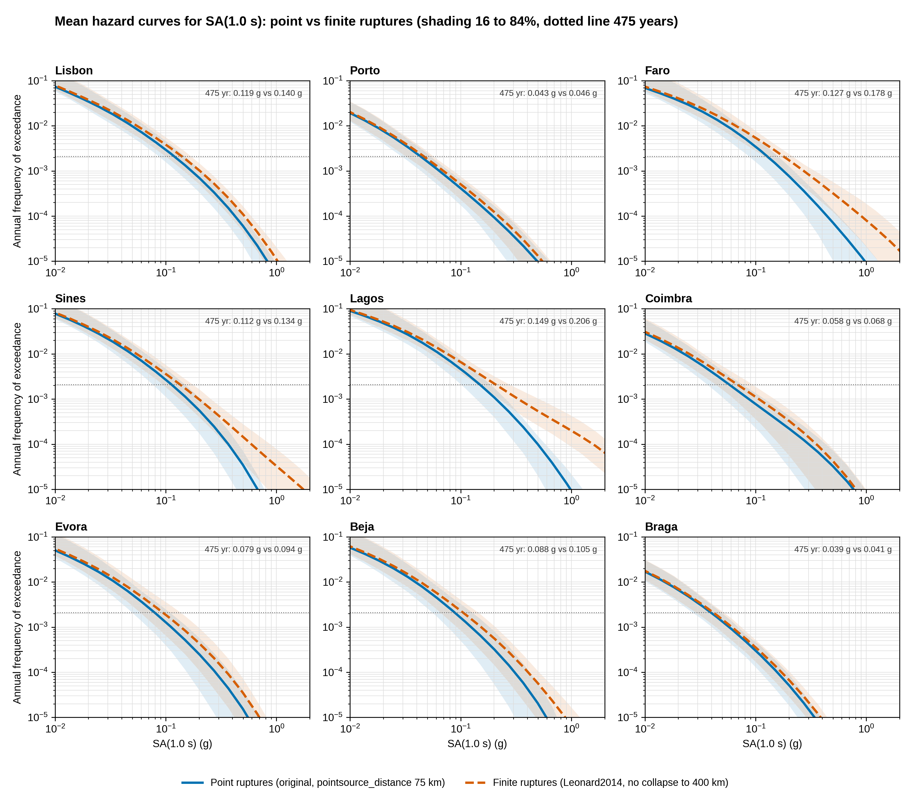

# PSHA sensitivity test: point vs finite ruptures (Portugal)

This folder compares two versions of the Portugal PSHA model (OpenQuake, `local_regional_hip2`, based on ESHM20).
The only change is how large ruptures are modelled in area and multi-point sources.

## Cases

**Case 1, point (original):** Every area and multi-point source uses `PointMSR`. Each rupture is a point at hypocentral depth, so Rjb equals the epicentral distance. `pointsource_distance = 75 km` collapses ruptures beyond that distance to points. M8 events in the Gulf of Cadiz are therefore treated as points, and the distance to the site is overestimated.

**Case 2, finite:** All area and multi-point sources use Leonard2014 (SCR inland, Interplate offshore). Ruptures have a real length and width, with aspect ratio 1.0, the original nodal planes and the original depths. `pointsource_distance = 400 km` means no collapse, so Rjb is measured to the rupture plane. Large events now sit much closer to the coast.

**Everything else is identical:** the source tree (21 branches), the GMM tree, Vs30 800 m/s, the IMTs and the sites.

**Effect:**

* The 475-year ground motion rises by 5–25% for PGA and 5–40% for SA(1.0 s).
* Lagos and Faro change most.
* The tails differ most at low annual frequencies.
* Runtime roughly doubles (1 min to 2 min).

## Results

Nine sites (Lisbon, Porto, Faro, Sines, Lagos, Coimbra, Évora, Beja, Braga). Mean hazard curves, shading shows the 16 to 84% quantiles, the dotted line marks a 475-year return period.

475-year ground motion (g):

| City | PGA point | PGA finite | Ratio | SA(1.0 s) point | SA(1.0 s) finite | Ratio |
|---|---|---|---|---|---|---|
| Lisbon | 0.182 | 0.204 | 1.12 | 0.119 | 0.140 | 1.17 |
| Porto | 0.076 | 0.082 | 1.08 | 0.043 | 0.046 | 1.07 |
| Faro | 0.221 | 0.271 | 1.23 | 0.127 | 0.178 | 1.40 |
| Sines | 0.160 | 0.183 | 1.14 | 0.112 | 0.134 | 1.19 |
| Lagos | 0.217 | 0.270 | 1.25 | 0.149 | 0.206 | 1.39 |
| Coimbra | 0.095 | 0.108 | 1.13 | 0.058 | 0.068 | 1.19 |
| Évora | 0.119 | 0.135 | 1.13 | 0.079 | 0.094 | 1.19 |
| Beja | 0.131 | 0.149 | 1.14 | 0.088 | 0.105 | 1.19 |
| Braga | 0.069 | 0.073 | 1.06 | 0.039 | 0.041 | 1.05 |

## Files

| File | Content |
|---|---|
| `figures/hazard_curves_PGA.png` | PGA mean hazard curves, 3×3 grid of cities |
| `figures/hazard_curves_SA1p0.png` | SA(1.0 s) mean hazard curves, 3×3 grid of cities |
| `results/psha_point_vs_finite_hazard.xlsx` | `Summary`: 475-year values and ratios. `PGA_curves`, `SA1p0_curves`: mean hazard curves (probability of exceedance in 50 years) for both cases |

## Run settings

* OpenQuake engine 3.21.0, classical PSHA, investigation time 50 years
* GMM logic tree with four branches: `KothaEtAl2020ESHM20` (high stress, slow attenuation), `Taherian2025ModifiedTest6` and `Morgadoetal2026` (inland and offshore variants)
* Site model: Vs30 800 m/s, ESHM20 region 5
* IMTs: PGA and SA(1.0 s), 30 intensity levels from 0.0005 g to 3 g
* Only the magnitude scaling relation and `pointsource_distance` differ between the two runs
